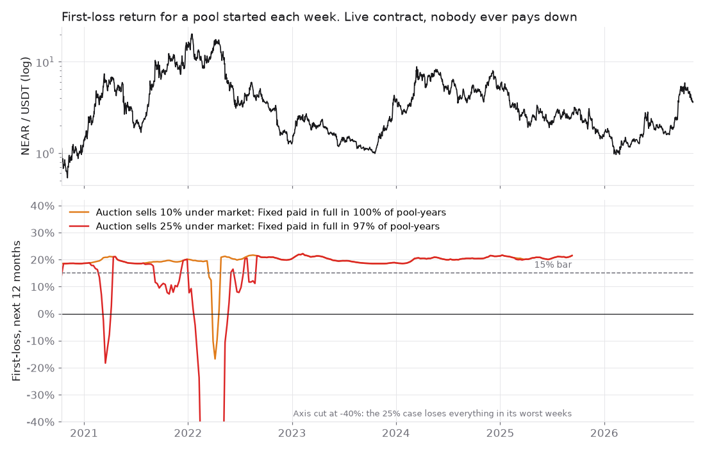

# Ankora

**Borrow dollars against your NEAR. A 3am dip can't sell it.**

Ankora lends USDC against NEAR for fixed 7 to 30-day terms and reads the price only when a term starts or renews, so a dip in between can't sell your collateral. In a backtest of NEAR's 2020–26 prices against a typical ~66.5% liquidation line, 60–68% of liquidations came on a day NEAR closed back above the line. Your NEAR stays staked with the validator you choose, inside a vault account opened for your loan. If NEAR has fallen too far at renewal, you get 72 hours' notice and 48 hours' grace before anything is auctioned, and any surplus comes back to you. Lenders deposit USDC from NEAR or from Base, Ethereum, Arbitrum, Polygon or Solana through NEAR Intents, and choose Fixed (paid first) or First-loss (takes losses first and can lose everything).

## Judging in 2 minutes

1. **Watch the demo** (1:50): [ankora.utpal.dev/demo/ankora-demo.mp4](https://ankora.utpal.dev/demo/ankora-demo.mp4)
2. **Read the thesis:** [research/THESIS.md](research/THESIS.md): why the protocol makes sense, with historical simulations.
3. **Check the live claims:** `node scripts/verify.mjs` (Node 22, no keys). **Rerun the numbers:** `python research/sim.py`. A `WARN` on the oracle line means Rhea's price feed is momentarily stale, not that a claim failed.
4. **Try it free on testnet:** [ankora.utpal.dev/app](https://ankora.utpal.dev/app/). Lending needs a little testnet NEAR for gas, plus test USDC from the app's faucet. Borrowing needs about 5.3 testnet NEAR. Faucets dry? [Open an issue](https://github.com/geekybot/ankora/issues) and we'll send testnet NEAR.
5. **Mainnet proof, no wallet needed:** [the pool](https://nearblocks.io/address/ankora.geekybot-1.near); three NEAR Intents deposits from Polygon and Solana ([1](https://nearblocks.io/txns/FCMW12YXWFF3L2g5mpxErKTSLPW4HfSYV2W1VF4KGhsV), [2](https://nearblocks.io/txns/BnykQzsdGbThiQ8JkrRyskhBbBU4bWy9dymNxtMU5YF6), [3](https://nearblocks.io/txns/9JBGJSdD7qmvc9oQ6iWWZ9RcgzUuh7PH2YtMR2En86Dc)); [loan #0](https://nearblocks.io/txns/HacmZYgrETBUcoaZvHGdj5RZYTjTcjqsFaJxNRxNpvo2). A mainnet borrow waits until the price is under 90 s old; this proof doesn't need a fresh price.

> [!IMPORTANT]
> **📈 [Read the thesis: why this protocol makes sense, with historical simulations →](research/THESIS.md)**
>
> - **60–68%** of liquidations on a 66.5% line (NEAR, 2020–26) came on a day NEAR closed back above the liquidation price.
> - The live contract, run on every weekly start since Oct 2020 with **no borrower ever paying down**: Fixed paid in full in **100%** of 257 pool-years, First-loss **19.5%** a year (10% auction discount).
> - Where it fails, too: at a 25% auction discount, First-loss falls to 1.8% in the 2021–22 crash.
> - One command reruns every number and chart: `python research/sim.py`.

[](research/THESIS.md)

**Status: built at NEAR HACKATHON (Nov 2026). Unaudited.** Testnet is the full product and free. Mainnet runs a capped build: deposits at most 200 USDC, loans at most 100 USDC, written into the contract.

| | Testnet (default) | Mainnet (capped) |
|---|---|---|
| App | [ankora.utpal.dev/app](https://ankora.utpal.dev/app/) | Same app, **Mainnet** switch in the header |
| Pool | `geekybot-ankora.testnet` | [`ankora.geekybot-1.near`](https://nearblocks.io/address/ankora.geekybot-1.near) |
| USDC | Test token with a faucet | Native USDC |
| Price | Team relay copying mainnet `aggregate-oracle.near` | `aggregate-oracle.near`, read by the contract. Rhea's signers push it irregularly; a borrow or renewal waits until it is under 90 s old |
| NEAR Intents | Live quotes only (no Intents testnet) | Real deposits in, real transfers out |
| Docs | [ankora.utpal.dev/docs](https://ankora.utpal.dev/docs/): mechanism, trust model, research with failures | |

## Check every claim (one command, read-only)

```bash
node scripts/verify.mjs
```
Node 22, no installs, no keys. It reads the mainnet pool's code hash and reproducible-build record, its caps (`get_limits`), keys and USDC registration, the oracle's age, the testnet pool's state, a live NEAR Intents route into the pool, and the hosted pages, and prints PASS or FAIL for each.

## What the team controls (read this first)

| Control | Who | Why it matters |
|---|---|---|
| The NEAR/USD price the pool reads | A relay contract the team owns, fed by our keeper from mainnet `aggregate-oracle.near` (the Pyth Pro feed Rhea's lending also reads) | The price at renewal decides notice and the auction's start price. Pyth no longer serves NEAR (Pyth Core dropped it on 26 Aug 2026), so testnet needs a relay |
| The pool contract | Upgradable through the deployer's full-access key | Per-loan vaults are not upgradable |
| Unsold auctions | The vault goes to the pool owner, who sells the NEAR and books the USDC | A trust point until a market sale replaces it |
| Test USDC | A test token with an open faucet (1,000 per call) | Testnet only |
| Mainnet caps | Constants in the `mainnet` build | No method raises them; raising them means a visible redeploy |
| Volatility menu | An owner switch (normal / stressed); stressed only shortens terms | Not yet an on-chain average |

**Before any cap is raised:** the pool's key removed or behind a timelock; prices verified on chain from two sources, with an on-chain average; a market sale for unsold vaults; an external audit.

## How it works

1. **Borrow.** Bring NEAR and pick a plan: up to 30% of its value for 30 days at 9.7% a year, 40% for 14 days at 10.1%, or 50% for 7 days at 11.3%. The first term's interest is taken from the loan.
2. **It stays staked.** A vault account created for your loan stakes the NEAR with your validator (any pool on the lockup whitelist). Native stakers unstake once (about 28 hours) to move in.
3. **At renewal.** At 50% LTV or below, the loan renews and the next term's interest is added to the debt. Above it: 72 hours' notice to pay down, 48 hours' grace, then a 24-hour Dutch auction from 100% to 50% of the price. No late fee.
4. **Repay any time.** The vault is handed back to you; unstake and withdraw from it like any staking account.
5. **Lend.** *Fixed* earns 6.5% a year on the share of the pool that is lent out (at 60% utilisation, 3.9% on the whole deposit), is paid first, and loses money only after every First-loss deposit is gone. *First-loss* takes losses first and keeps what the pool earns beyond that; it can lose everything and is locked for 36 days. Ankora keeps 5% of interest.
   - Why Fixed accrues on lent cash only: if it earned 6.5% on idle cash, First-loss would pay that from its own deposit and lose money until the pool was about 60% lent. The pool keeps an accrual clock that runs at utilisation, so First-loss is never charged for idle cash.
6. **From and to other chains (NEAR Intents).** A deposit message `{"depositfor":{"tranche":"senior","account":"alice.near"}}` credits the named account, so USDC that NEAR Intents 1Click delivers from Base, Ethereum, Arbitrum, Polygon or Solana lands as a deposit for the user who sent it. On mainnet the app gets the one-time deposit address and tracks the transfer; *Send to another chain* takes USDC from the NEAR wallet (a withdrawal or a loan payout) back out to those chains in one wallet approval. NEAR Intents has no testnet, so the testnet app shows live mainnet quotes and executes nothing.
7. **Auctions are on record.** Every auction is stored with its outcome (sold, repaid, no buyer), price and buyer; `get_auction_history` lists them newest first.

## Try it

- **Testnet app (free):** [ankora.utpal.dev/app](https://ankora.utpal.dev/app/).
  - **No wallet:** the pool, rates, open auctions and auction history load without one.
  - **Lend:** any testnet wallet with a little NEAR for gas. Get test USDC from the app's faucet (1,000 per click).
  - **Borrow:** a testnet wallet with about 5.3 NEAR (3.5 staked, 1.5 for the loan's vault account, about 0.3 held for gas). Testnet NEAR comes from [near-faucet.io](https://near-faucet.io/) or the [NEAR docs faucet](https://docs.near.org/getting-started/faucet); both can run dry, and near-faucet.io gives about 2 NEAR a claim. If both are dry, ask the team for testnet NEAR. The app's wallet picker lists Meteor, Intear and others; switch the wallet to testnet.
- **On your machine, no testnet needed:** a full stack on a local NEAR sandbox, with the live mainnet price and controls to crash the price and skip time.
  ```bash
  cd contracts && ./build.sh
  ```
  ```bash
  cd client && npm install && npm run local
  ```
  ```bash
  cd app && npm install && npm run dev
  ```
  The app signs as a local dev account and shows demo controls: *Drop NEAR 50%* and *Skip to the loan's deadline* run a loan through notice, grace and a Dutch auction in a minute. `POST localhost:8090/price?usd=1` holds NEAR at $1; `POST localhost:8090/advance?secs=604800` skips a week.
- **Mainnet (real money, capped):** switch to **Mainnet** in the app header and connect a NEAR wallet. Lend from another chain under *Fund from another chain*, or from the NEAR wallet.

## Code

| Folder | What it is |
|---|---|
| [`contracts/`](contracts/) | Rust (near-sdk 5.30): the pool (tranches, loans, renewal, notice, auction), the per-loan vault, test stand-ins. Mechanism, deploy steps and known limits in its README |
| [`client/`](client/) | TypeScript (`@ankora/client`): pool views and actions, quote maths mirrored from the contracts, the testnet keeper, deploy and local-chain scripts |
| [`app/`](app/) | The web app (Vite + TypeScript), reading and writing only through `@ankora/client` |

Tests: 99 contract tests (unit and sandbox end to end), 43 client tests. CI runs them on every push.

```bash
cd contracts && ./build.sh && cargo test --workspace --lib && cargo test -p ankora-pool --test flow -- --test-threads=1
```
```bash
cd client && npm test
```

## Built during the hackathon, and with what

- **Window:** every commit here is from 11–13 Nov 2026, inside the NEAR HACKATHON window. The research behind the parameters (models of NEAR's 2020–2026 history, pre-registered pass criteria) was done from 9 Nov and is summarised in the [docs](https://ankora.utpal.dev/docs/#research). There is no pre-hackathon code.
- **Libraries:** near-sdk 5.30 and cargo-near (contracts), near-kit and @hot-labs/near-connect (chain access and wallets), Vite and TypeScript (app), vitest (tests), near-sandbox (end-to-end tests).
- **Services:** NEAR Intents 1Click API (cross-chain deposits and transfers), Rhea's `aggregate-oracle.near` (NEAR/USD), NEAR Foundation's `lockup-whitelist.near` (eligible validators).
- **Design assets:** Geist fonts; a front-end kit for the landing page's layout and motion (`site/assets`); a kinetic-grid background adapted from a Framer component.
- **AI:** written with Claude Code as a coding assistant, reviewed and directed by the team.

## License

[MIT](LICENSE).
