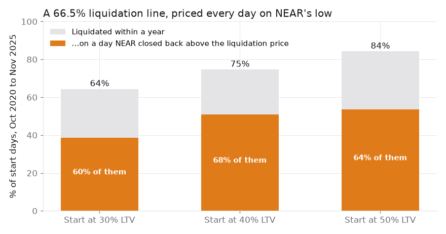
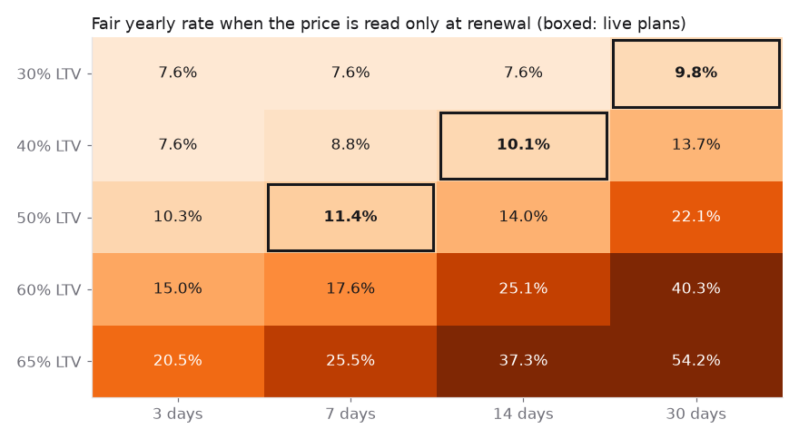
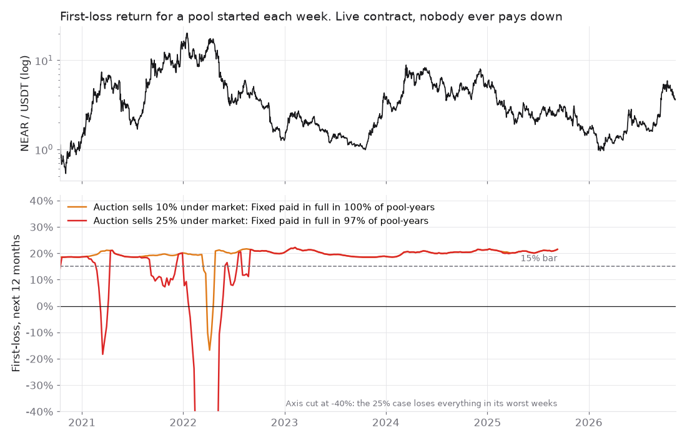

# Ankora: the thesis

**Claim:** a NEAR holder should be able to borrow dollars against staked NEAR without an intraday dip selling the collateral. A lender can fund that loan at a fixed 6.5% behind a First-loss layer, as long as the price is read only when a term starts or renews and terms stay short.

This page explains why, with the numbers. Every chart and table here comes from one script you can run: [`sim.py`](sim.py) on [NEAR/USDT daily prices](data/near_usdt_daily.csv) (Binance, Oct 2020 to Nov 2026). The output is in [`results.md`](results.md).

```bash
pip install numpy pandas matplotlib && python research/sim.py
```

---

## 1. The problem: liquidation lines sell on dips that don't last

A NEAR lending market such as Rhea checks the loan against the price continuously and sells collateral the moment the line (about 66.5% LTV) is crossed, even if only for an hour.

We tested a passive borrower who opens a one-year loan on every day from Oct 2020 to Nov 2025, and checked the line against each day's low:



| Start LTV | Liquidated within a year | Of those, NEAR closed that same day back above the liquidation price |
|---|---|---|
| 30% | 64% | **60%** |
| 40% | 75% | **68%** |
| 50% | 84% | **64%** |

In most liquidations the borrower lost collateral, at a liquidator's discount, to a move that had reversed by the day's close.

**What Ankora does instead:**
- It reads the price once, when a term starts or renews.
- Nothing can happen to the collateral during the term.
- At renewal above 50% LTV, the borrower gets 72 hours' notice to pay down, then 48 hours' grace.
- Only after that is the vault auctioned, over 24 hours, and any surplus goes back to the borrower.

## 2. The market: staked NEAR is the big pool, and native stakers are unserved

| | Size | On Rhea | On Ankora |
|---|---|---|---|
| Native stake with a chosen validator | About $1.88B, about 91% of staked NEAR | Must unstake, then hold idle NEAR or a liquid staking token: the validator or the yield is lost | Unstake once (about 28 h), then the loan's vault re-stakes with **the same validator** (any pool on `lockup-whitelist.near`) |
| Liquid staking tokens | About $194M | Accepted | Not in v1 |
| Rhea USDC | $12.8M supplied, $1.85M free cash; an $18.4M exploit in April 2026 | | Lenders can come from other chains through NEAR Intents (Base, Ethereum, Arbitrum, Polygon, Solana) |

DefiLlama and on-chain reads, Nov 2026. Whether native stakers want dollar loans is **untested**: no NEAR market serves them today, so their demand can't be observed.

## 3. Pricing: a loan is a put, and NEAR jumps

Merton (1974) shows that a lender holds a loan with no default risk minus a put on the collateral, struck at the debt. A loan with no mid-term sale is exactly that put, running for the term plus the time it takes to sell.

**NEAR moves in jumps, not smoothly:**
- smooth volatility of 103% a year, plus about 8 jumps a year with a standard deviation of 22.5%;
- worst day −45%.

**Black-Scholes underprices that.** At 50% LTV over 3 days it prices an expected loss of 0.40 points against 2.10 actually realised. Of the models we tested, just one never priced below NEAR's actual losses across 16 LTV × term cells: Merton's jump-diffusion.

The resulting fair rate also includes the First-loss capital and utilisation:



**What the surface decides:**
- **Anything above 50% LTV costs 15–54% a year**, so Ankora doesn't offer it.
- The three plans live in the contract are:
  - 30% LTV for 30 days at 9.7%;
  - 40% for 14 days at 10.1%;
  - 50% for 7 days at 11.3%.
- The surface shows them at their 2-day / 5% sale cost; the contract rates come from the full-history fit.

## 4. Lenders: the live contract through 2021–22

[`sim.py`](sim.py) runs the exact contract parameters on every weekly pool start (257 pool-years):
- the three plans;
- renewal only at 50% LTV or below;
- above that, notice, grace and auction, so the sale lands 6 days after the renewal check;
- 15% First-loss, 6.5% Fixed, 5% fee, 3.4% staking yield.

The borrower model is the worst case: **no borrower ever pays down**, so every vault above 50% at renewal is auctioned.



| Auction sells under market by | Window | Fixed paid in full | First-loss mean a year | First-loss losing years |
|---|---|---|---|---|
| 5% | All weekly starts | 100% | 19.9% | 0% |
| **10%** | **All weekly starts** | **100%** | **19.5%** | **1.2%** |
| 10% | 2021–22 crash | 100% | 18.7% | 2.9% |
| 25% | All weekly starts | 97.3% | 12.7% | 8.2% |
| 25% | 2021–22 crash | **93.3%** | **1.8%** | **20.2%** |

The bars, set in the research rounds before the original runs:
- Fixed paid in full in at least 99% of pool-years;
- First-loss mean at least 15%;
- First-loss losing in at most 15% of years.

**Up to a 10% auction discount the design passes all three, including the 2021–22 crash. At a 25% discount it fails.** The auction discount is the number that matters most for lenders.

## 5. Borrowers: asked to act as often, treated differently

This is a weakness, not a selling point. **A passive Ankora borrower is asked to pay down slightly more often than a passive borrower on a liquidation line is liquidated**, because a 50% renewal line is tighter than 66.5%.

| Start LTV | 66.5% line: liquidated within a year | Ankora: a renewal above 50% within a year |
|---|---|---|
| 20% | 37% | 51% |
| 30% | 64% | 73% |
| 40% | 74% | 82% |

The difference is in how it happens:

| | Liquidation line | Ankora |
|---|---|---|
| Trigger | Any intraday price | The price at renewal only |
| Warning | None | 72 h notice, then 48 h grace |
| Penalty | Liquidator's discount | None; auction surplus goes back to the borrower |
| Collateral during the loan | Often unstaked, or a liquid staking token | Natively staked with the borrower's validator |

## 6. What we tested and dropped (so you can trust what's left)

Each idea had a pass bar written down before its data ran. These failed:

| Tested | Result |
|---|---|
| A perp aggregator over NEAR Intents (the starting idea) | Killed: about 0% out-of-sample carry at real costs |
| A renewal ladder up to 65% LTV | Killed: fair rates of 15–54% above 50% |
| The same ladder with a realistic 5-day / 10% sale | Fixed paid in full in only 94.3% of 2021–22 start-weeks: this led to the 50% cap and short terms |
| Rates fitted on calm 2023–26 data, tested on the unseen 2021–22 crash | **Failed**: First-loss 11.3%, under the 15% bar. The live rates use the full history, so section 4 includes the period they were fitted on. Volatility inputs must come from the whole cycle, never a calm window |
| A 1-hour moving average (EMA) in place of spot | Ran up to 9.1% above spot (a 24-hour average up to 40.5%), so the contract values collateral at spot or lower |

## 7. Open risks

| Risk | What it means |
|---|---|
| Auction discount | Staked NEAR takes about 28 hours to unstake, so buyers may want a discount. Above about 10% under market, First-loss fails its bar (section 4) |
| One collateral asset | Every loan falls together; nothing diversifies |
| Price source | Mainnet reads `aggregate-oracle.near`, which Rhea's signers update irregularly. A borrow or renewal waits until the price is under 90 seconds old. There is no on-chain average yet |
| Demand | No borrower or First-loss buyer has been interviewed. Native-staker demand is unobserved |
| Code | **Unaudited.** Mainnet is capped in the contract: deposits at most 200 USDC, loans at most 100 USDC |
| Staking yield | NEAR's emission cut (HSP-029) lowers staking yield from about 5.3% to 3.4%. That moves lender results by about 0.01 points but shrinks the share of interest staking covers |

**Model simplifications:**
- daily closes stand in for Ankora's single price read, and daily lows for the liquidation line;
- the pool is 90% lent;
- Fixed is paid on the whole senior share (the contract pays it on lent cash only, which is kinder to First-loss);
- borrowers start at 20–40% LTV in four staggered weekly cohorts.

## Sources and further reading

- Merton (1974), *On the Pricing of Corporate Debt*. Merton (1976), jump-diffusion option pricing.
- [MYSO](https://myso-finance.gitbook.io/myso-v2-docs/v2-protocol-overview/pricing-loans), the closest precedent: loans never sold mid-term, priced with Black-Scholes.
- [Gudgeon et al., AFT 2020](https://arxiv.org/abs/2006.13922): utilisation rate models. [Morpho AdaptiveCurveIRM](https://docs.morpho.org/morpho/contracts/irm/adaptive-curve-irm).
- [Chitra (2019)](https://arxiv.org/abs/2001.00919): lending that pays more than staking pulls stake out of consensus. Ankora keeps the collateral staked.
- Contract parameters: [`plans.rs`](../contracts/ankora-core/src/plans.rs), [`loans.rs`](../contracts/ankora-core/src/loans.rs), [`tranche.rs`](../contracts/ankora-core/src/tranche.rs).
- Mechanism and trust model: [ankora.utpal.dev/docs](https://ankora.utpal.dev/docs/).
